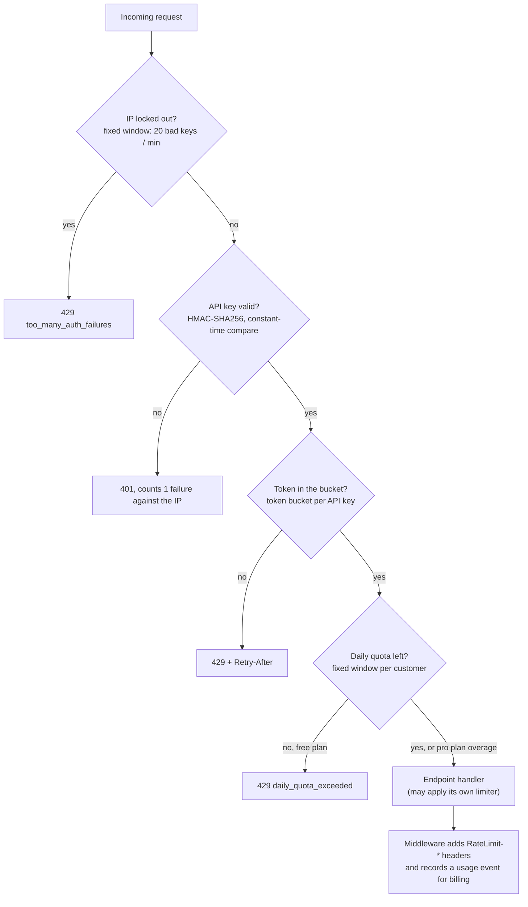
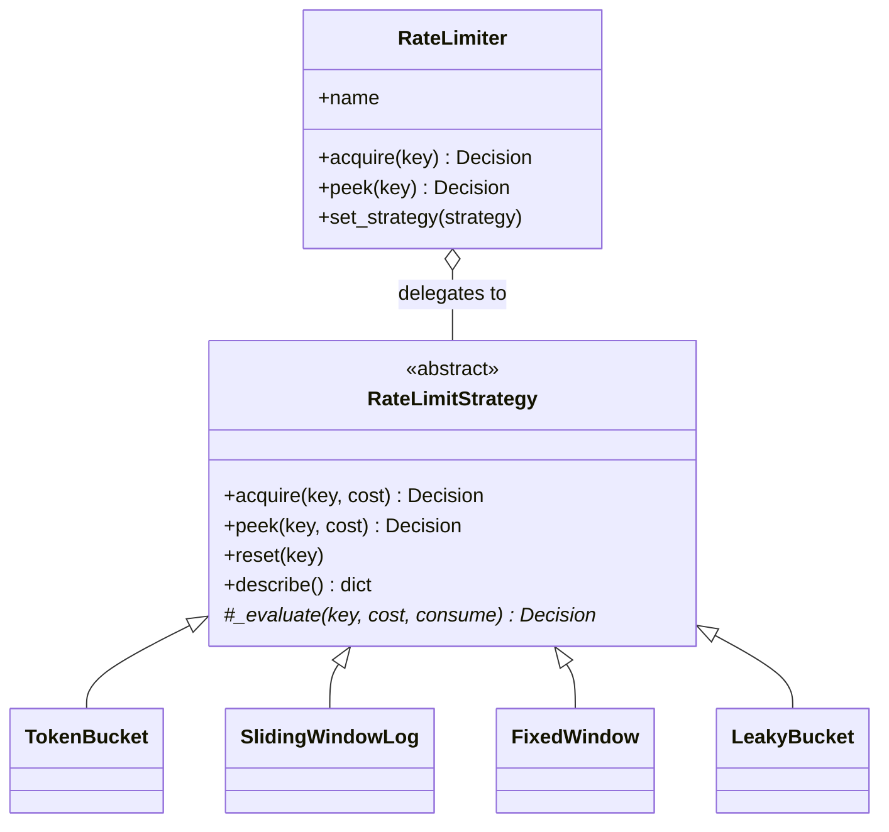
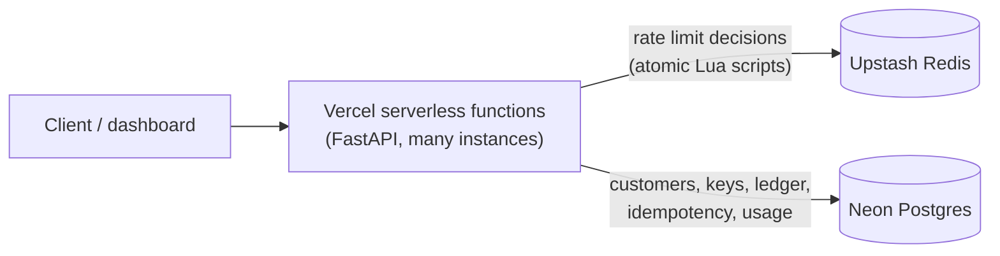

# Ledgerline: rate limiting a banking API

A sandbox Bank-as-a-Service API built to show how rate limiting works in a real
system. Developers sign up, get an API key, and call endpoints for accounts,
transfers and payouts. Behind those endpoints, **four rate limiting algorithms**
each guard the part of the bank they're best suited to.

**Live demo:** https://rate-limit-project.vercel.app · [Dashboard](https://rate-limit-project.vercel.app/dashboard) · [Interactive API docs](https://rate-limit-project.vercel.app/docs) · [Step-by-step guide](https://rate-limit-project.vercel.app/guide)

> **New to the project?** The [step-by-step guide](https://rate-limit-project.vercel.app/guide) explains it in
> 17 short steps: every algorithm, design decision, trade-off and production bug, each with a self-check question.

Runs on Vercel serverless functions, with **Postgres** (Neon) for customers, keys
and the ledger, and **Redis** (Upstash) for rate limiter state. All the money is
sandbox money.

---

## Contents

1. [Try it in one minute](#try-it-in-one-minute)
2. [What happens to every request](#what-happens-to-every-request)
3. [The four algorithms](#the-four-algorithms)
   - [Token bucket: everyday API traffic](#1-token-bucket-everyday-api-traffic)
   - [Sliding window: transfer fraud limits](#2-sliding-window-log-transfer-fraud-limits)
   - [Fixed window: quotas, billing and lockouts](#3-fixed-window-quotas-billing-and-lockouts)
   - [Leaky bucket: payouts to the payment network](#4-leaky-bucket-payouts-to-the-payment-network)
   - [Side by side](#side-by-side)
4. [Design: the Strategy pattern](#design-the-strategy-pattern)
5. [Endpoint reference: what happens inside each one](#endpoint-reference)
6. [Other backend design points](#other-backend-design-points)
7. [Run it locally](#run-it-locally)
8. [Architecture and deployment](#architecture-and-deployment)
9. [Project layout](#project-layout)

---

## Try it in one minute

The easiest way is the **[dashboard](https://rate-limit-project.vercel.app/dashboard)**:
sign up, then press the buttons in the **Rate limit lab**. Each button runs one
algorithm and colours every request green (accepted), amber (queued or
replayed) or red (rate limited).

From a terminal:

```bash
BASE=https://rate-limit-project.vercel.app    # or http://127.0.0.1:8000 locally

# 1. Sign up. The key is shown once; only a hash is stored.
KEY=$(curl -s -X POST $BASE/v1/signup -H 'Content-Type: application/json' \
  -d '{"name":"Acme","email":"me@example.com"}' | python3 -c 'import sys,json;print(json.load(sys.stdin)["api_key"])')

# 2. Fire 12 requests as fast as possible: the token bucket allows 10, then 429s.
for i in $(seq 12); do curl -s -o /dev/null -w "%{http_code} " -H "X-API-Key: $KEY" $BASE/v1/accounts; done

# 3. Look inside every limiter without using anything up.
curl -s -H "X-API-Key: $KEY" $BASE/v1/limits
```

In [Swagger](https://rate-limit-project.vercel.app/docs), click **Authorize**, paste
the key, and every endpoint becomes clickable.

---

## What happens to every request

Every authenticated call passes through the same pipeline. Each check is a
separate limiter, and the first one to say no ends the request.



Every response tells the client where it stands, using the IETF draft
`RateLimit` headers:

```http
HTTP/1.1 200 OK
RateLimit-Policy: token_bucket          # which limiter is closest to blocking you
RateLimit-Limit: 10                     # its capacity
RateLimit-Remaining: 9                  # what's left right now
RateLimit-Reset: 1                      # seconds until it's fully replenished
X-Daily-Quota-Remaining: 999
```

A blocked request gets `429` with a `Retry-After` header and a body saying which
algorithm blocked it and why:

```json
{
  "detail": {
    "error": "rate_limited",
    "policy": "token_bucket",
    "message": "Too many requests for this API key. The free plan allows bursts of 10 and 2 requests/second sustained.",
    "retry_after_seconds": 0.434
  }
}
```

---

## The four algorithms

| Banking problem | Algorithm | Keyed by | Settings |
|---|---|---|---|
| Everyday API calls (balances, history) | **Token bucket** | API key | free: burst 10, refills 2/s · pro: burst 50, refills 20/s |
| Daily quota and billing | **Fixed window** | customer | free: 1,000/day (hard limit) · pro: 50,000/day (then billed overage) |
| Transfer fraud limits | **Sliding window log** | source account | 5 transfers per rolling 60 s |
| Payouts to the payment network | **Leaky bucket** | customer | queue of 20, sent out at 1/s |
| Guessing API keys | **Fixed window** | client IP | 20 failures/min |
| Sandbox signups | **Fixed window** | client IP | 10/hour |

All limiters work the same basic way. Each keeps a little **state per key** (per
API key, per account, per IP). When a request arrives, it updates that state for
the time that has passed since the last request, then decides. There are no
background timers: refilling and draining are calculated lazily from timestamps.

### 1. Token bucket: everyday API traffic

**The banking problem.** When a customer opens a banking app, it fires about 10
calls at once: accounts, balances, recent transactions, notifications. Then it
goes quiet. A limit of "2 requests per second" would break that app launch, but
with no limit at all one client could hammer the API.

**How it works.** Each API key has a bucket holding up to `capacity` tokens. Each
request spends one token. Tokens drip back in at `refill_rate` per second, up to
the capacity. An empty bucket means 429.

State kept per key: just two numbers, `(tokens, last_refill_time)`.

```python
tokens = min(capacity, tokens + (now - last) * refill_rate)   # catch up on refills
if tokens >= 1:
    tokens -= 1          # allowed
else:
    retry_after = (1 - tokens) / refill_rate                    # time until 1 token exists
```

**Worked example (free plan: capacity 10, refill 2/s):**

| Time | Event | Tokens after | Result |
|---|---|---|---|
| 0.0 s | App opens, 10 calls at once | 10 → 0 | 10 × `200` |
| 0.0 s | 11th call | 0 | `429`, `retry_after` = 1 ÷ 2 = **0.5 s** |
| 0.5 s | Retry | 0 + 0.5 × 2 = 1 → 0 | `200` |
| 5.5 s | Quiet for 5 s | refilled to 10 (capped) | next burst can happen |

That's why a blocked call shows `RateLimit-Reset: 5`: an empty bucket takes
10 ÷ 2 = 5 s to fill completely.

**Why this algorithm here:** it allows **bursts** while capping the **long-run
average**, which is how real client apps behave.
→ [`app/ratelimit/token_bucket.py`](app/ratelimit/token_bucket.py)

### 2. Sliding window log: transfer fraud limits

**The banking problem.** If an account is compromised, an attacker tries to
drain it fast. Banks cap how many transfers can leave an account in a short
period. This is a security control, so it has to be **exact**: no loophole an
attacker can time.

**How it works.** For each account, store the timestamp of every accepted
transfer. On a new transfer, discard timestamps older than 60 s, then count
what's left. If there are 5, block. The window is always "the last 60 seconds
ending right now", so it slides with the clock.

State kept per account: a queue of up to 5 timestamps.

```python
while log and log[0] <= now - window:   # drop entries that slid out of the window
    log.popleft()
if len(log) < limit:
    log.append(now)                     # allowed
else:
    retry_after = log[0] + window - now  # when the oldest entry slides out
```

**Worked example (5 per 60 s):**

| Time | Window covers | Timestamps in window | Result |
|---|---|---|---|
| 12:00:10, :20, :30, :40, :50 | – | 1, 2, 3, 4, 5 | 5 × `201` |
| 12:01:05 | 12:00:05 → 12:01:05 | 5 | `429`, retry in **5 s** (when :10 expires) |
| 12:01:11 | 12:00:11 → 12:01:11 | 4 (:10 slid out) | `201` |

**Why not a fixed window?** A fixed window resets at each minute boundary, and
that boundary is a loophole:

```
fixed window:    |----- 12:00 window -----|----- 12:01 window -----|
attacker:                          ×××××  ×××××
                                12:00:59  12:01:00   → 10 transfers in 1 second, all allowed

sliding window:  any 60 s span may contain at most 5   → the second 5 are blocked
```

Both cases are tests: `test_fixed_window_allows_boundary_burst` and
`test_sliding_window_blocks_boundary_burst` in
[`tests/test_strategies.py`](tests/test_strategies.py).

**Trade-off:** memory is O(limit) per key. That's fine for 5 transfers, but it
would be wasteful for "10,000 requests/hour". At that scale, a *sliding window
counter* (two fixed-window counts, weighted) approximates this in O(1) memory.
→ [`app/ratelimit/sliding_window.py`](app/ratelimit/sliding_window.py)

### 3. Fixed window: quotas, billing and lockouts

**The banking problem.** API plans are sold as "1,000 calls per day". That's a
contract and billing term, so the customer needs a **predictable** reset ("every
day at 00:00 UTC") that can be printed on an invoice. "Any rolling 24 hours"
would be impossible to explain on a bill.

**How it works.** Time is cut into aligned windows. The window number is
`floor(now / window_length)`, and each key has one counter for the current
window. When the window number changes (midnight UTC), the counter starts again
from 0.

State kept per key: `(window_number, count)`.

```python
window_id = int(now // window)                 # e.g. days since 1970
if stored_window_id != window_id: count = 0    # new day: reset
if count < limit: count += 1                   # allowed
else: retry_after = (window_id + 1) * window - now   # seconds until midnight UTC
```

**Worked example (free plan, 1,000/day):**

| Time (UTC) | Count | Result |
|---|---|---|
| 09:00 → 23:10 | 1 … 1,000 | `200` |
| 23:10 | 1,000 | `429 daily_quota_exceeded`, retry in **50 min** |
| 00:00 next day | 0 → 1 | `200`: new window |

**Free vs pro.** On free, reaching the quota means 429. On pro, the request is
still served, but the response carries `X-Quota-Overage: true` and the call is
billed at the overage rate. The same algorithm drives a hard limit in one plan
and a billing tier in the other.

The same algorithm also protects **authentication**: 20 bad API keys from one IP
in a minute locks that IP out until the minute ends. It also limits **signups**
on the public sandbox (10 per IP per hour). For those, the boundary loophole
doesn't matter, and one integer per IP is as cheap as it gets.
→ [`app/ratelimit/fixed_window.py`](app/ratelimit/fixed_window.py)

### 4. Leaky bucket: payouts to the payment network

**The banking problem.** Payouts to other banks go through a payment network
(ACH, Faster Payments, a partner bank's API). These networks accept a **steady
rate** of messages and penalise or reject spikes. A business submitting payroll
for 20 employees has 20 payouts arriving at once. They should all be
*accepted* immediately, but *sent* evenly.

**How it works.** Picture a bucket with a hole in the bottom. Each payout pours
in one unit, and the hole drains at a constant `leak_rate`. If a new unit would
overflow the bucket, that payout is rejected. Because the drain rate is
constant, a payout's position in the bucket tells us exactly **when it will be
sent**.

State kept per customer: `(level, last_leak_time)`.

```python
level = max(0, level - (now - last) * leak_rate)   # drain since last time
if level + 1 <= capacity:
    delay = level / leak_rate                       # everything ahead of me drains first
    level += 1                                      # accepted, sent at now + delay
else:
    retry_after = (level + 1 - capacity) / leak_rate
```

**Worked example (queue 20, sent at 1/s), one payroll batch of 22 payouts:**

| Payout | Bucket level before | Result | `queue_delay_seconds` |
|---|---|---|---|
| Employee 1 | 0 | queued | 0.0 (sent now) |
| Employee 2 | 1 | queued | 1.0 |
| … | … | … | … |
| Employee 20 | 19 | queued | 19.0 |
| Employee 21 | 20 (full) | **rejected** `queue_full` | retry in 1.0 s |
| Employee 22 | 20 (full) | **rejected** `queue_full` | retry in 1.0 s |

**Token bucket vs leaky bucket.** Both use a "bucket", but they do opposite
jobs. A token bucket **lets bursts through** to the backend, as long as the
average stays under the limit. A leaky bucket **absorbs bursts** and sends work
on at a fixed pace, so the backend never sees a spike. Use the token bucket to
protect your own API, and the leaky bucket to protect a slow system downstream.

> In this sandbox there's no real payment network: a payout's status in
> `GET /v1/payouts` flips from `queued` to `dispatched` once its `dispatch_at`
> time passes.

→ [`app/ratelimit/leaky_bucket.py`](app/ratelimit/leaky_bucket.py)

### Side by side

| | Token bucket | Sliding window log | Fixed window | Leaky bucket |
|---|---|---|---|---|
| Allows bursts? | Yes, up to capacity | Yes, up to the limit | Yes, and up to 2× at a boundary | Accepts them but **sends them evenly** |
| Exact over any span? | Average only | **Yes** | No (boundary loophole) | Yes (output rate) |
| Memory per key | 2 numbers | O(limit) timestamps | 2 numbers | 2 numbers |
| Reset is predictable? | No (continuous) | No (rolling) | **Yes** (clock-aligned) | No (continuous) |
| Used here for | API traffic | transfer fraud limits | quotas, lockouts | payouts |

---

## Design: the Strategy pattern

Every algorithm is an interchangeable **strategy** behind one interface, and the
application only talks to a **context** object. Endpoints never know which
algorithm they're using.



- **[`RateLimitStrategy`](app/ratelimit/base.py)** is the interface. `acquire()`
  (consume) and `peek()` (look without consuming) are written **once** in the
  base class: they take the lock and call the abstract `_evaluate(key, cost,
  consume)`. Each algorithm only implements its own maths.
- **[`RateLimiter`](app/ratelimit/limiter.py)** is the context. It holds a
  strategy, prefixes keys with its own name, and exposes `set_strategy()` to
  swap algorithms while the app is running.
- **[`create_strategy`](app/ratelimit/factory.py)** is a factory that turns a
  config entry into a strategy, which makes [`app/policies.py`](app/policies.py)
  plain data:

```python
SHARED_POLICIES = {
    "transfer_velocity": ("sliding_window", {"limit": 5, "window": 60}),
    "payout_rail":       ("leaky_bucket",   {"capacity": 20, "leak_rate": 1.0}),
    "auth_failures":     ("fixed_window",   {"limit": 20, "window": 60}),
    "signups":           ("fixed_window",   {"limit": 10, "window": 3600}),
}
```

Moving auth lockout to a sliding window is a one-line config change, and no
endpoint code changes.

**Where the state lives is a strategy choice too.** Every algorithm has two
implementations behind the same interface:

| | In-memory (`TokenBucket`, …) | Redis (`RedisTokenBucket`, …) |
|---|---|---|
| State | Python dicts in the process | Redis hashes, sorted sets and counters with TTLs |
| Atomicity | a `threading.Lock` | one **Lua script** per decision; Redis runs it as a single step |
| Use | local dev, tests | production: many serverless instances share one limiter |

```python
create_strategy("token_bucket", capacity=10, refill_rate=2)                                # memory
create_strategy("token_bucket", backend="redis", redis=client, capacity=10, refill_rate=2)  # Redis
```

The Lua script is what makes the Redis version correct. Without it, two
instances could both read "1 token left" and both spend it. Inside a script,
the read, the decision and the write can't be interleaved with anything else.
This is the token bucket's script ([`redis_strategies.py`](app/ratelimit/redis_strategies.py)):

```lua
local state  = redis.call('HMGET', KEYS[1], 'tokens', 'ts')
local tokens = tonumber(state[1]) or capacity
local last   = tonumber(state[2]) or now
tokens = math.min(capacity, tokens + math.max(0, now - last) * rate)   -- refill
local allowed = tokens >= cost
if allowed then tokens = tokens - cost end                              -- spend
redis.call('HSET', KEYS[1], 'tokens', tostring(tokens), 'ts', tostring(now))
redis.call('PEXPIRE', KEYS[1], math.ceil(capacity / rate * 1000) + 1000)  -- idle keys clean themselves up
```

The sliding window uses a sorted set of timestamps (`ZREMRANGEBYSCORE` drops
expired entries, `ZCARD` counts what's left). The fixed window uses one
`INCRBY` counter per window, which expires at the window's end. The leaky bucket
stores `(level, ts)` the way the token bucket stores `(tokens, ts)`.

The algorithm tests run against **both** backends, and the whole API suite runs
once with each, so the two implementations can't drift apart.

---

## Endpoint reference

All endpoints take `X-API-Key: bk_live_…` (or `Authorization: Bearer bk_live_…`)
except signup. Money is always **integer cents** (`2500` = $25.00).

| Method | Path | Limiters applied (beyond auth) |
|---|---|---|
| POST | [`/v1/signup`](#post-v1signup) | fixed window per IP |
| GET | [`/v1/accounts`](#get-v1accounts-and-get-v1accountsidbalance) | token bucket + daily quota |
| GET | [`/v1/accounts/{id}/balance`](#get-v1accounts-and-get-v1accountsidbalance) | token bucket + daily quota |
| GET | [`/v1/accounts/{id}/transactions`](#get-v1accountsidtransactions) | token bucket + daily quota |
| POST | [`/v1/transfers`](#post-v1transfers) | token bucket + quota + **sliding window** per account |
| POST | [`/v1/payouts`](#post-v1payouts-and-post-v1payoutsbatch) | token bucket + quota + **leaky bucket** |
| POST | [`/v1/payouts/batch`](#post-v1payouts-and-post-v1payoutsbatch) | token bucket + quota (1 call) + **leaky bucket per payout** |
| GET | `/v1/payouts` | token bucket + daily quota |
| GET | [`/v1/limits`](#get-v1limits) | none (management) |
| GET | [`/v1/usage`](#get-v1usage) | none (management) |
| GET / POST / DELETE | `/v1/keys`, `/v1/keys/{id}` | none (management) |

"Management" endpoints still require a valid key, but they don't use up rate
limits or quota and aren't billed. A customer whose limits are used up can still
open the dashboard to find out why.

### `POST /v1/signup`

Creates a customer on the `free` or `pro` plan, two demo accounts (Checking
$5,000 and Savings $20,000, with 60 past transactions) and the first API key.

**Inside:**
1. **Fixed window** on the client IP: 10 signups per hour.
2. A 40-character random key is generated: `bk_live_<8-char prefix>_<32-char secret>`.
3. Only `HMAC-SHA256(pepper, secret)` and the prefix are stored. The full key is
   returned **once** and can never be shown again.

```json
{
  "customer_id": 1,
  "plan": "free",
  "api_key": "bk_live_RKcNm7pO_bTfDdWR7dcj7Qqj7cc6gkfMqef0zz2QX",
  "warning": "Store this key now. Only a hash is kept; it cannot be shown again."
}
```

### `GET /v1/accounts` and `GET /v1/accounts/{id}/balance`

Lists your accounts, or returns one account with its balance.

**Inside:**
1. Auth: find the key row by its **prefix** (indexed), then compare the HMAC of
   the secret in constant time.
2. **Token bucket** for this API key takes one token.
3. **Fixed window** daily quota for this customer adds one to the count.
4. Ownership check: another customer's account returns `404`, not `403`, so
   account IDs can't be probed.

```json
{ "data": [
    { "id": 1, "name": "Checking", "currency": "USD", "balance_cents": 500000 },
    { "id": 2, "name": "Savings",  "currency": "USD", "balance_cents": 2000000 }
] }
```

### `GET /v1/accounts/{id}/transactions`

Transaction history, newest first, with **cursor pagination**: `?limit=20&cursor=…`.

**Inside:**
1. The same token bucket and quota as above.
2. The cursor is an opaque base64 value holding the last ID you saw. The query
   is `WHERE id < :cursor ORDER BY id DESC LIMIT :limit + 1`, and the extra row
   tells us whether `has_more` is true.

**Why cursors instead of `?page=3`?** A bank ledger is written to all the time.
With offset paging, every new transaction shifts each page by one, so clients
skip or see rows twice. Cursors stay stable, and they use the index, so page
1,000 is as fast as page 1.

```json
{
  "data": [
    { "id": 60, "amount_cents": -5824,  "description": "Grocer",   "created_at": 1793577294.5 },
    { "id": 59, "amount_cents": -21506, "description": "Bookshop", "created_at": 1793573694.5 }
  ],
  "has_more": true,
  "next_cursor": "eyJpZCI6IDU5fQ"
}
```

### `POST /v1/transfers`

Moves money between accounts. **Requires an `Idempotency-Key` header.**

```bash
curl -X POST $BASE/v1/transfers -H "X-API-Key: $KEY" \
  -H "Idempotency-Key: $(uuidgen)" -H 'Content-Type: application/json' \
  -d '{"from_account_id":1,"to_account_id":2,"amount_cents":2500,"description":"Rent share"}'
```

**Inside, in order:**
1. Token bucket and daily quota.
2. **Idempotency check.** Has this key been seen before?
   - Same key, same body, finished: return the **stored response**
     (`Idempotent-Replayed: true`). No money moves and **the fraud limit isn't charged again**.
   - Same key, different body: `422 idempotency_key_reused`.
   - Same key, first request still running: `409 request_in_progress`.
3. Validation: you own the source account, the destination exists, and they're
   different accounts.
4. **Sliding window** fraud limit on the *source account*: 5 per rolling 60 s.
   This runs after validation, so typos don't use up your limit.
5. In **one database transaction**: check the balance, debit, credit, write both
   ledger rows, and store the response under the idempotency key. Either all of
   that happens, or none of it does.
6. If the request was rate limited (429), the idempotency key is **released**,
   so the client can retry later with the *same* key.

```json
// 201 Created (a retry with the same key returns exactly this, plus Idempotent-Replayed: true)
{ "id": 62, "status": "completed", "from_account_id": 1, "to_account_id": 2,
  "amount_cents": 2500, "description": "Rent share", "created_at": 1793580894.52 }

// 429 on the 6th transfer within 60 s
// RateLimit-Policy: sliding_window   Retry-After: 60
{ "detail": { "error": "rate_limited", "policy": "sliding_window",
  "message": "Transfer velocity limit: at most 5 outgoing transfers per account in any 60 seconds.",
  "retry_after_seconds": 59.965 } }
```

### `POST /v1/payouts` and `POST /v1/payouts/batch`

Sends money to an external beneficiary through the (simulated) payment network.
**Requires `Idempotency-Key`.** The batch endpoint takes up to 100 payouts in one
call, like a payroll file.

**Inside:**
1. Token bucket and daily quota. A batch is **one API call**, so it costs one
   token however many payouts it carries.
2. The idempotency check, as for transfers.
3. For each payout: check the balance, then the **leaky bucket** for this
   customer. Accepted payouts are debited and get a `dispatch_at` time.
   Overflow is rejected **per item** in a batch (the single endpoint returns
   `429`).

```json
// 202 Accepted: 22 payouts submitted, 20 fit in the queue
{
  "accepted": 20,
  "rejected": 2,
  "payouts": [
    { "id": 1,  "beneficiary": "Employee 1",  "status": "queued", "queue_delay_seconds": 0.0,  "dispatch_at": 1793580894.56 },
    { "id": 2,  "beneficiary": "Employee 2",  "status": "queued", "queue_delay_seconds": 1.0,  "dispatch_at": 1793580895.56 },
    { "id": 20, "beneficiary": "Employee 20", "status": "queued", "queue_delay_seconds": 19.0, "dispatch_at": 1793580913.56 },
    { "beneficiary": "Employee 21", "status": "rejected", "reason": "queue_full", "retry_after_seconds": 1.0 }
  ]
}
```

### `GET /v1/limits`

**A live look inside every limiter** for your key. It's read with `peek()`, so
calling it uses nothing up. Call it between other requests to watch the token
bucket drain and refill, the transfer window slide, and the payout queue empty.

```json
{
  "api_traffic": {
    "algorithm": "token_bucket", "burst": 10, "refill_per_second": 2,
    "key": "key:1", "remaining": 9, "next_request_allowed": true,
    "retry_after_seconds": 0.0, "reset_after_seconds": 0.493
  },
  "daily_quota": {
    "algorithm": "fixed_window", "limit": 1000, "window_seconds": 86400,
    "key": "cust:1", "remaining": 990, "reset_after_seconds": 83105.4
  },
  "transfer_velocity": [
    { "algorithm": "sliding_window", "limit": 5, "window_seconds": 60,
      "key": "acct:1", "remaining": 0, "next_request_allowed": false, "retry_after_seconds": 59.952 }
  ],
  "payout_rail": { "algorithm": "leaky_bucket", "queue_capacity": 20, "dispatch_per_second": 1.0, "...": "..." }
}
```

### `GET /v1/usage`

Usage metering and billing estimate. It's built from the usage events the
middleware writes for every call, including the 429s.

```json
{
  "plan": "free",
  "today": { "quota": 1000, "quota_used": 19, "quota_remaining": 981, "resets_at": "2026-11-03T00:00:00+00:00" },
  "daily": [ { "date": "2026-11-02", "calls": 22, "billable": 18, "rate_limited": 4 } ],
  "by_endpoint": [
    { "endpoint": "GET /v1/accounts",   "calls": 13, "rate_limited": 3 },
    { "endpoint": "POST /v1/transfers", "calls": 7,  "rate_limited": 1 }
  ],
  "billing": { "period": "2026-11", "billable_calls": 18, "overage_calls": 0, "estimated_cents": 0 }
}
```

Only successful calls (status < 400) are billable. 429s are counted so you can
see them, but you don't pay for being rate limited. Pro plans pay $0.40 per 1k
calls within the quota and $0.80 per 1k overage.

### `GET|POST /v1/keys`, `DELETE /v1/keys/{id}`

List keys (shown as `bk_live_<prefix>_…` only), create additional keys (for
example one per environment), or revoke a key. Revocation takes effect on the
very next request.

---

## Other backend design points

- **Hashed API keys** ([`app/security.py`](app/security.py)). Only an HMAC of the
  secret is stored, using a server-side *pepper* kept outside the database, so a
  leaked database dump can't be used to test guesses. API keys are 190 bits of
  randomness and can't be brute-forced like passwords, so a fast keyed hash is
  the right tool here (not bcrypt). The public prefix gives an indexed lookup,
  and the comparison is constant-time.
- **Idempotency** ([`app/idempotency.py`](app/idempotency.py)). The
  "in-progress" marker is written first and committed on its own, so a
  concurrent duplicate sees it. The response is stored in the **same
  transaction** as the money movement. Markers older than 60 s from a crashed
  request are taken over, and keys expire after 24 h.
- **Metering** ([`app/middleware.py`](app/middleware.py)). A plain ASGI
  middleware sees the final status code of every request, including 429s raised
  inside dependencies. It adds the `RateLimit-*` headers and writes one usage
  event per call.
- **Money safety.** Integer cents, a `CHECK (balance_cents >= 0)` constraint, an
  atomic conditional debit, and each transfer plus its idempotency record in
  one transaction.
- **Client IP behind a proxy.** On Vercel, every request reaches the app from
  Vercel's proxy, so per-IP limits read the real client from `X-Forwarded-For`.
  That header is trusted **only** when running behind the proxy; otherwise anyone
  could spoof their IP and dodge the lockout.

---

## Run it locally

Requires Python 3.9+.

```bash
python3 -m venv .venv
.venv/bin/pip install -r requirements-dev.txt
.venv/bin/uvicorn app.main:app --reload
```

- Dashboard: http://127.0.0.1:8000/dashboard
- API docs: http://127.0.0.1:8000/docs
- Tests (65 tests; every algorithm is driven by a fake clock and runs on both backends): `.venv/bin/pytest -q`

Locally, the app uses a SQLite file and in-memory limiters with zero setup.
Set `DATABASE_URL` and/or `REDIS_URL` to use Postgres and Redis instead. To run
the API tests against a real Postgres, each test in its own throwaway schema:
`TEST_DATABASE_URL=postgresql://… .venv/bin/pytest tests/test_api.py`

---

## Architecture and deployment



Vercel runs the app as serverless functions: many short-lived instances, none
with a lasting disk. Anything that has to be shared between them lives outside
the function:

| State | Where | Why |
|---|---|---|
| Customers, API keys, accounts, ledger, idempotency keys, usage events | **Postgres** (Neon) | durable and transactional. A key created by one instance works on every other. |
| Rate limiter state | **Redis** (Upstash) | every request reads and writes it, so it has to be fast and atomic. TTLs clean up idle keys. |

A first version kept both in each instance's memory and `/tmp`. In a live test,
one client's 10th request landed on a second instance where its API key didn't
exist (`401`), even at a single user's traffic. That's why the shared stores
are there.

Details that matter on serverless:
- **Connection pooling.** Each instance keeps a small `psycopg_pool` connected to
  Neon's PgBouncer endpoint, with prepared statements turned off as PgBouncer
  requires.
- **Schema setup** runs lazily on first use, behind a Postgres advisory lock so
  two cold-starting instances don't race on `CREATE TABLE`.
- **Money safety without row locks.** A debit is a single
  `UPDATE … SET balance = balance - x WHERE id = ? AND balance >= x`. Postgres
  serialises concurrent updates to the same row, so two simultaneous transfers
  can't both pass the balance check.
- **Clocks.** Limiter scripts take the app's `now` (instances are NTP-synced)
  and guard against small clock skew with `max(0, now - last)`.

### Deploying your own copy

1. Import the repository at https://vercel.com/new. No build settings are needed:
   Vercel detects FastAPI and serves [`api/index.py`](api/index.py).
2. Add the **Neon** and **Upstash for Redis** integrations from the Vercel
   Marketplace (both have free plans) and connect them to the project. They set
   `DATABASE_URL` and `REDIS_URL` for you.
3. Add an environment variable `API_KEY_PEPPER` with a random value:
   `python3 -c "import secrets; print(secrets.token_urlsafe(32))"`
4. Deploy. Every later `git push` redeploys automatically.

---

## Project layout

```
app/
  main.py              endpoints
  deps.py              auth + rate limit enforcement (FastAPI dependencies)
  policies.py          which algorithm guards what (config, built via the factory)
  middleware.py        RateLimit-* headers + usage metering
  idempotency.py       Idempotency-Key handling
  metering.py          usage report + billing estimate
  pagination.py        opaque cursors
  security.py          API key generation + HMAC hashing
  db.py                Postgres / SQLite access + schema
  ratelimit/
    base.py            RateLimitStrategy interface + Decision
    token_bucket.py    sliding_window.py    fixed_window.py    leaky_bucket.py
    redis_strategies.py  the same four algorithms as atomic Redis Lua scripts
    limiter.py         RateLimiter (Strategy context)
    factory.py         create_strategy(algorithm, backend=...)
  static/dashboard.html
api/index.py           Vercel entrypoint
tests/                 strategy unit tests + API tests
```
